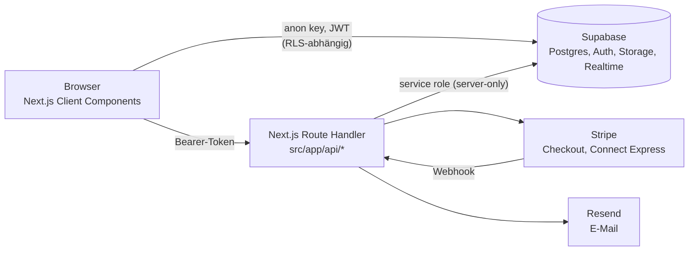
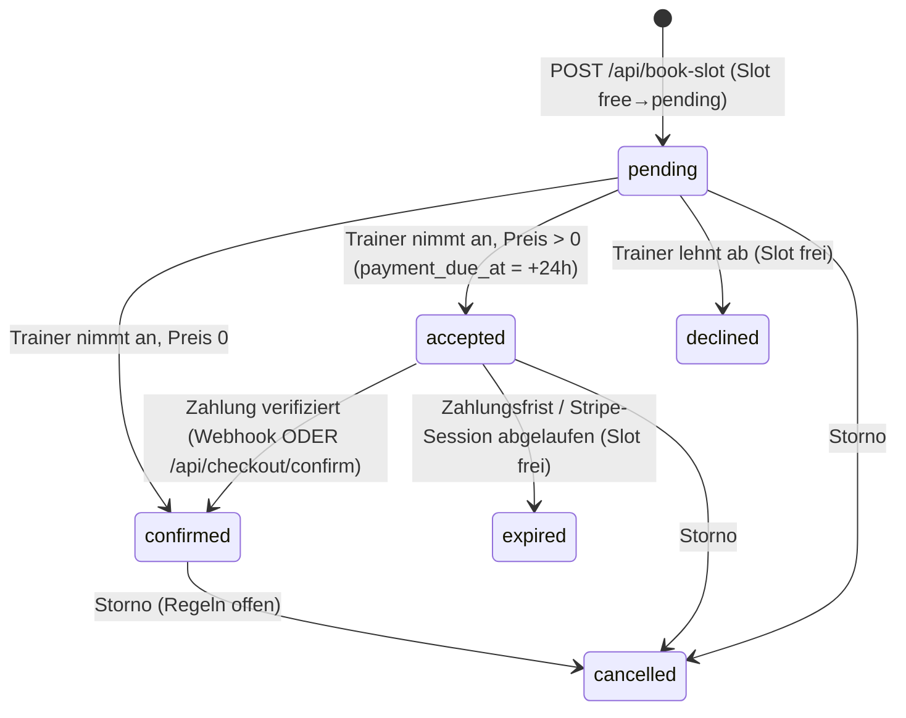

# VeriFit – Architektur

Dieses Dokument beschreibt **wie** VeriFit technisch aufgebaut ist. Produktziele: `docs/PRD.md`. UI: `docs/DESIGN_SYSTEM.md`. Arbeitsregeln: `AGENTS.md`. Detaildokumente: `docs/payment-flow.md`, `docs/auth-flow.md` (teilweise veraltet), `docs/database-schema.md` (teilweise veraltet), `docs/db/*` (Export).

- Stand: 11.10.2026. Grundlage: Code-Snapshot (ohne `src/lib/constants.ts` und `src/app/api/cancel-booking/route.ts`, die nicht vorlagen), die eine Migration im Repo und der DB-Export `docs/db/*` (Stand 03.10.2026). Es gab **keinen Zugriff** auf die tatsächliche Staging- oder Produktionsdatenbank.
- Marker: **bestätigt** (Code/Migration), **Export** (nur `docs/db/*`), **Entscheidung**, **geplant**, **offen** – Definition in `AGENTS.md` §2. Zielarchitektur wird nie als umgesetzt dargestellt.

## 1. Systemüberblick



Zwei Zugriffspfade auf Daten: **(A)** der Browser spricht Supabase direkt mit dem anon-Key und dem Nutzer-JWT an; die Datenbank (RLS, Storage-Policies, RPCs) ist dort die einzige Sicherheitsgrenze. **(B)** Mutierende Aktionen mit Geld, Status oder fremden Daten laufen über Route Handler, die das Token prüfen und mit dem Service-Role-Key arbeiten. Pfad (A) ist der größte Risikobereich (§5, §12).

## 2. Stack und Laufzeit

| Bereich | Technologie (Version laut `package.json`) |
|---|---|
| Web | Next.js 16.3.4 App Router, React 19.2.8, TypeScript 5 strict |
| Styling | Tailwind CSS 4 (`@tailwindcss/postcss`), lucide-react |
| Backend-Dienste | Supabase (`@supabase/supabase-js` 2.x), Region Frankfurt/EU |
| Zahlungen | `stripe` 22.x (serverseitig; Checkout per Redirect) |
| E-Mail | `resend` 6.x |
| Validierung | zod 4 |
| Hosting | Vercel (Entscheidung: Pro vor erstem Live-Zahlungsfluss) |

Hinweise: `package.json` hat **kein** `engines`-Feld, Next 16 verlangt Node ≥ 20.9, die Supabase-Pakete im Lockfile Node ≥ 22; Ziel laut `release-plan`: Node 22 in `engines` (**geplant**). `@supabase/ssr` und `@stripe/stripe-js` sind installiert, in den vorliegenden Dateien aber **nicht verwendet** (Session liegt im Standard-Browserspeicher). Es gibt kein Test-Script; Qualitätssicherung heute: `npm run lint`, `npm run build`.

## 3. Umgebungen und Konfiguration

- Umgebungen: lokal, **Staging** (Supabase-Projekt, Arbeitsumgebung), Produktion (nicht anfassen ohne Freigabe).
- Variablennamen (Werte nie ausgeben): `NEXT_PUBLIC_SUPABASE_URL`, `NEXT_PUBLIC_SUPABASE_ANON_KEY`, `SUPABASE_SERVICE_ROLE_KEY` (nur Server), `STRIPE_SECRET_KEY`, `STRIPE_WEBHOOK_SECRET`, `NEXT_PUBLIC_APP_URL` (ohne Slash; Fallback `NEXT_PUBLIC_SITE_URL` in `connect-link`), `RESEND_API_KEY`, `RESEND_FROM_EMAIL` (Fallback `onboarding@resend.dev`; laut Resend-Test-Absender nur eingeschränkt nutzbar, **zu prüfen**), geplant `CRON_SECRET`, `PLATFORM_FEE_PERCENT`. Eine `.env.example` fehlt (**geplant**).
- `src/app/lib/supabase.ts` fällt ohne Umgebungsvariablen auf Platzhalter-URL/-Key zurück (für deterministische Builds); in Deployments müssen die Variablen gesetzt sein, sonst laufen Browser-Aufrufe ins Leere.
- Supabase-Auth-Einstellungen (Redirect-URLs, Site-URL, E-Mail-Bestätigung, SMTP, Rate-Limits) liegen im Dashboard, nicht im Repo (**offen**, §12.4).

## 4. Projektstruktur und Verantwortlichkeiten

| Pfad | Verantwortung |
|---|---|
| `src/app/**/page.tsx` | Seiten (überwiegend Client Components, Datenladen per Hook/`useEffect`); `loading.tsx`, `error.tsx`, `global-error.tsx`, `not-found.tsx`, `robots.ts`, `sitemap.ts` (statisch, ohne Trainerseiten) |
| `src/app/api/**/route.ts` | Route Handler: `book-slot`, `respond-booking`, `checkout`, `checkout/confirm`, `webhook`, `cancel-booking` (Datei im Snapshot nicht vorhanden), `delete-account`, `stripe/connect-link`, `stripe/sync-account`, `admin/trainer-status`, `admin/verification-document` |
| `src/app/lib/supabase.ts` | Browser-Client (anon key) |
| `src/app/lib/supabaseServer.ts` | `server-only`: Admin-Client (service role), `getRequestAuthentication` (Token → Nutzer → `profiles.role`), `getUserClient(token)` für RPCs im Nutzerkontext |
| `src/app/lib/bookingPayments.ts` | `finalizePaidBooking` (idempotent), Mailversand |
| `src/app/lib/resend.ts`, `lib/validation/*` | Resend-Client; zod-Schemas (auth, booking, admin) |
| `src/components/` | Gemeinsame UI (`AppShell`, `Chat`, `TrendChart`, `SpecialtyPicker`, `DeleteAccountCard`, `StripeReturnSync`, `Skeleton`, `FormError`, ungenutzt: `Footer`) |
| `src/components/trainer-dashboard/` | UI-Sektionen des Trainer-Dashboards; `src/hooks/trainer-dashboard/` Daten-Hooks; `src/lib/trainer-dashboard/` Typen, Konstanten, Utils |
| `src/lib/` | `constants.ts` (Fachgebiete, einzige Quelle für Quiz + Trainer; nicht im Snapshot), `trackingMetrics`, `useAuthProfile`, `nextParam`, `authErrors` |
| `src/proxy.ts` | Next-16-Proxy (Nachfolger von `middleware.ts`); **leitet alles unverändert durch** (§6) |
| `supabase/migrations/` | Eine Migration (`20261005120000_…`): Spalten `health`/`motivation`, `share_data`-Default `false`, Fremdschlüssel von `bookings.client_id/trainer_id` entfernt, Funktion `delete_user_data` (nur `service_role`) |

Datenfluss-Konvention (**bestätigt**): Seiten/Hooks laden Daten direkt aus Supabase (kein Repository-Pattern, kein globaler State). Neue Features folgen diesem Muster, wo kein Geld/Status/fremde Daten betroffen sind.

## 5. Datenzugriff: Browser direkt vs. Route Handler

Jede Zeile „Browser direkt“ ist **ohne passende RLS-Policy nicht abgesichert** und muss in der Testmatrix (`anon`, Client A/B, Trainer A/B, Admin) auftauchen.

| Tabelle / Ressource | Browser direkt (Dateien) | Nur Route Handler / RPC |
|---|---|---|
| `profiles` | SELECT eigene Zeile (`useAuthProfile`, Logins) | Rolle schreibt nur der Auth-Trigger |
| `clients` | SELECT/UPDATE eigene Zeile (Client-Dashboard); SELECT durch Trainer (`useClients`, `Chat`, Kundenübersicht) | Insert via Trigger/`book-slot` liest per Admin |
| `trainers` | SELECT öffentlich (Liste, Profil, Quiz, Admin-Seite `select('*')`); UPDATE eigene Zeile (Profil, Fachgebiete, Lizenzfelder, Avatar, Dokumentpfade) | `status` via `admin/trainer-status`; Stripe-Felder via `stripe/*` |
| `trainer_offers` | SELECT öffentlich, CRUD eigene (`useTrainerSchedule`) | – |
| `trainer_slots` | SELECT öffentlich, INSERT/DELETE eigene freie Slots | Statuswechsel `free/pending/booked` serverseitig (Admin-Client, RPC) |
| `bookings` | nur SELECT (Kunde, Trainer) | INSERT/UPDATE: `book-slot`, `respond_to_booking`, `cancel_booking`, Checkout, Webhook, `delete-account` |
| `client_plans` | INSERT durch Trainer (Planer), SELECT durch Kunde | – |
| `client_trackings` | CRUD durch Kunde; SELECT durch Trainer (Kundenübersicht) | – |
| `foods` | SELECT, INSERT (Trainer-Planer) | – |
| `messages` | SELECT/INSERT, Realtime-Subscription | – |
| Storage `verification-docs` | Upload/Löschen/Signed URL im eigenen Ordner (`DocumentUploadCard`) | Admin-Signed-URL via `admin/verification-document` |
| Storage `avatars` | Upload (`ProfileSection`), öffentliche URL | – |

Route-Handler-Muster (**bestätigt**): `getRequestAuthentication` (Token per `admin.auth.getUser`, Rolle aus `profiles` per Admin-Client) → Rollen-/Eigentümerprüfung → zod → Aktion; Preise und Kundendaten kommen aus der Datenbank, nie aus dem Request.

## 6. Authentifizierung und Autorisierung

- Auth: Supabase Auth (E-Mail/Passwort). Registrierung per `signUp` im Browser mit Rolle in `options.data.role`; ein Datenbank-Trigger `handle_new_user` (nicht im Repo, Definition nur im **Export**) legt `profiles` an. Der Code der Registrierung erwartet zusätzlich, dass der Trigger Kunden-/Trainerprofil anlegt („atomar im Trainerprofil“) – die exportierte Funktion tut das **nicht** (**Widerspruch, offen**).
- Rollen: `profiles.role` ∈ `client|trainer|admin`. Login-Seiten prüfen die Rolle nach `signInWithPassword` und melden bei Mismatch ab. Server: `getUserRole` liest `profiles.role` (Vertrauensanker aller Admin-/Trainer-/Kundenrouten – deshalb ist SEC-1 kritisch).
- **Clientseitige Guards** (Redirects in Dashboards, `useTrainerAccount` mit `user.id === routeId`, Admin-Seite) sind Komfort, keine Sicherheitsgrenze. `src/proxy.ts` ruft in jedem Fall `NextResponse.next()` auf. Die Session liegt im Browser-Standardspeicher (nicht in Cookies); serverseitiges Rendering kennt den Nutzer nicht. Die Migration auf Cookie-Sessions (`@supabase/ssr`) und serverseitige Rollenprüfung für `/admin`, `/client/*`, `/trainer/*/dashboard` ist **geplant** (Phase 2, S7).
- Wirkung: Der Schutz der Daten hängt vollständig an Route-Handler-Checks und RLS; die Admin-**Seite** ist für jeden ladbar, ihre Aktionen laufen jedoch über Admin-Routen mit Rollenprüfung.

## 7. Datenmodell

**Ist laut Code-Nutzung** (maßgeblich gegenüber `docs/database-schema.md`):

| Tabelle | Zweck / wichtige Felder |
|---|---|
| `profiles` | `id` (= Auth-ID), `email`, `role` |
| `clients` | `id`, `email`, `name`, `share_data`, `height`, `age`, `gender`, `goal`, `activity_level`, `weight` |
| `trainers` | `id`, `name`, `email`, `bio`, `status` (`pending/approved/rejected`), `city`, `service_mode`, `specialties` (Komma-String), `license_number`, `liability_insurance_expiry`, `license_document_path`, `insurance_document_path`, `avatar_url`, `hourly_rate`, `qualifications`, `instagram_url`, `tiktok_url`, `stripe_account_id`, `charges_enabled`; Legacy: `package_*`, `document_url`, `availability_status` |
| `trainer_offers` | `trainer_id`, `title`, `type` (`discovery/paid`), `duration_minutes`, `price`, `description`, `is_active` |
| `trainer_slots` | `trainer_id`, `slot_date`, `slot_time`, `status` (`free/pending/booked`); Legacy-Spalten `is_booked`, `title`, `price`, `client_name`, `client_email` |
| `bookings` | Snapshot (`offer_title`, `offer_type`, `duration_minutes`, `price`, `slot_date`, `slot_time`, `client_name`, `client_email`), `slot_id`, `offer_id`, `status` (`pending/accepted/confirmed/declined/cancelled/expired`), `payment_due_at`, `responded_at`, `paid_at`, Stripe-IDs; `cancelled_at` wird vom Code geschrieben |
| `client_plans` | `trainer_id`, `user_id`, `plan_type` (`workout/nutrition`), `title`, `content` (JSON-String), `created_at` |
| `client_trackings` | `client_id`, `created_at`, `weight`, `calories`, `water`, `sleep`, `mood`, `health`, `motivation` (zwei letztere per Migration) |
| `foods` | `name`, `kcal/protein/carbs/fat` je 100 g |
| `messages` | `sender_id`, `receiver_id`, `content`, `created_at` |
| Legacy, im Code ungenutzt | `appointments`, `nutrition_plans`, `workout_plans` (RLS an, ohne Policies) |

Indizes laut **Export**: eindeutiger aktiver Buchungsindex je Slot (`uq_active_booking_per_slot`: `slot_id` bei `pending/accepted/confirmed`), eindeutig `(trainer_id, slot_date, slot_time)`, `clients.email`, `profiles.email`, `foods.name`.

**Abweichungen Code ↔ Export (Schema ist nicht reproduzierbar, offen):** im Export fehlen `client_plans`, `trainers.avatar_url/hourly_rate/qualifications/slug/stripe_account_id/charges_enabled`, `clients.weight`, `bookings.cancelled_at`, `client_trackings.health/motivation` (Letztere kommen per Migration). Das Export-Datum (03.10.) liegt vor Migration (05.10.) und README-Update; entweder ist der Export veraltet oder Funktionen im Code schlagen fehl. Beispiele für Folgen bei fehlendem Schema: Planversand (`client_plans`), Trainer-Kundenübersicht (explizites `select … weight`), `delete_user_data` (löscht aus `client_plans`).

Zielschema: Hilfsfunktion `is_admin()`, View `trainers_public`, Tabellen `consents`, `plan_templates`, Spalten `slug`, `target_levels`, `verified` (**geplant**, `docs/release-plan.md`).

## 8. Buchung und Zahlung

Details und Ablauf: `docs/payment-flow.md`. Hier nur Statusmodell und Abweichungen.



- **bestätigt (Code):** Slot-Reservierung bedingt (`update … eq status free`), Rückrollen bei fehlgeschlagenem Insert; `respond_to_booking` per RPC im Nutzerkontext; Checkout nur für eigene, `accepted`, fristgültige Buchung, Preis aus der Datenbank, Idempotency-Key `verifit-booking-<id>`, Session läuft zu `payment_due_at` ab; `finalizePaidBooking` setzt `accepted→confirmed` nur bei `payment_status = paid` und gültiger Frist, ist idempotent, Mails nur beim echten Übergang; Webhook mit Signaturprüfung behandelt `completed`, `async_payment_succeeded/failed`, `expired`, `account.updated`; Fallback `/api/checkout/confirm` prüft die Session bei Stripe.
- **Stripe Connect:** Onboarding (Express-Konto, `account_onboarding`-Link) und Statusabgleich (`sync-account`) **bestätigt**. Der Checkout läuft **ohne** `application_fee_amount`/`transfer_data`; Auszahlung an Trainer und 15 %-Provision sind **geplant** (Phase 3). `charges_enabled` wird bei Buchung/Annahme nicht geprüft.
- **Abweichung Slot-Status (offen, zu prüfen):** Die exportierte `respond_to_booking` setzt bei **jeder** Annahme den Slot auf `booked`, `docs/payment-flow.md` und der Webhook-Ablaufpfad (`update … eq status pending`) gehen für bezahlte Buchungen von `pending` aus. Folge, falls der Export dem Live-Stand entspricht: Läuft die Zahlung ab, wird der Slot vom Webhook nicht freigegeben (nur `expire_unpaid_bookings` gibt ihn frei).
- **Verfall:** `expire_unpaid_bookings()` existiert laut Export, ein Aufrufer (Cron `/api/cron/expire-bookings`, `CRON_SECRET`) fehlt (**geplant**). 24-h-Antwortfrist/Anti-Ghosting nicht umgesetzt.
- **Storno:** `/api/cancel-booking` + RPC `cancel_booking` existieren (Route nicht einsehbar). Die exportierte RPC verweigert Storno bezahlter, bestätigter Buchungen, die UI verspricht Erstattung bis 24 h vor Termin (**Widerspruch, offen**, `docs/PRD.md` §9).
- **Ausführbarkeit:** `delete_user_data` und Teile der Routen setzen Schema voraus, das der Export nicht zeigt (§7).

## 9. Trainerverifizierung und Storage

- Ablauf (**bestätigt**): Trainer lädt PDFs in `verification-docs` unter `<trainerId>/<kind>-<timestamp>.pdf` (Prüfung PDF/10 MB nur im Browser), speichert den Pfad in `trainers`. Admin-Route erzeugt Signed URL (60 s) nur für Pfade, die in `trainers.license_document_path` oder `insurance_document_path` stehen. Trainer-Ansicht eigener Dokumente per `createSignedUrl` im Browser (nur eigener Ordner laut Policy).
- Policies laut **Export**: `verification-docs` – Admin liest alle, Trainer lesen/löschen/laden im eigenen Ordner; `trainer-documents` – Lesen und Hochladen ohne Nutzereinschränkung (Bucket im Code **unbenutzt**, Existenz/Inhalt unbekannt). Bucket-Limits (Größe, MIME) und `avatars`-Policies sind nicht exportiert (**offen**). Ausweis-Upload und Löschung nach Prüfung sind **geplant**.
- `avatars`: öffentlicher Bucket (Annahme laut Code `getPublicUrl`), Schreiben im Ordner `<trainerId>/` (Policy **nicht** belegt).

## 10. Chat, Realtime, E-Mail

- Chat (`Chat.tsx`): Kontakte per Direktabfrage (Trainer → `clients`, Kunde → **alle** `trainers`), Nachrichten per `.or(and(sender…),and(…))`, Realtime-Kanal `chat_messages` auf `INSERT` ohne serverseitigen Filter, clientseitige Filterung. Nach Supabase-Dokumentation respektiert `postgres_changes` RLS-SELECT-Policies (nicht selbst geprüft); ob `messages` in der Publication `supabase_realtime` steht, ist **offen** (Export fehlt). Die UUID-Interpolation in `.or()` ist unkritisch (UUIDs aus der Datenbank).
- E-Mail: Resend aus Route Handlern (Buchung, Antwort, Zahlung, Trainer-Status). Nutzer-/DB-Inhalte werden mit `escapeHtml` escaped (**bestätigt**); Mailfehler machen Statusänderungen nicht rückgängig. Hinweis: Trainer-Mails gehen an `trainers.email` – ein Wert, den ein Trainer selbst setzt.

## 11. Tests, Migrationen, Deployment

- Tests: keine automatisierten Tests erkennbar. **Geplant:** RLS-Tests in `supabase/tests/rls` mit `anon`, Client A/B, Trainer A/B, Admin (erwartete Ergebnisse als Matrix im PR).
- Migrationen: Ziel ist vollständige, idempotente, kommentierte Schema-Quelle in `supabase/migrations/`; heute **eine** Datei. Ausführung zuerst in Staging, nie nur im Dashboard (`AGENTS.md` §5).
- Deployment: Vercel; Produktionsdeployments und Änderungen an Produktionskonfiguration nur nach Freigabe. Go-Live-Checkliste (**geplant**, `docs/RELEASE-REPORT.md`): Stripe Live-Keys + Webhook, Vercel Pro, Supabase Pro/Backups, Site-URL/Redirects, SMTP, DNS, Impressum.
- Build-Beobachtung (**zu verifizieren mit `npm run build`**): `src/app/trainer/[id]/page.tsx` importiert `parseSpecialties` aus `@/lib/trainer-dashboard/utils`, wo es im Snapshot nicht exportiert wird (das Quiz importiert es aus `@/lib/constants`, Datei nicht vorliegend).

## 12. Sicherheitsstatus

### 12.1 Methode und Grenzen

Read-only-Prüfung von Repo-Snapshot, der einen Migration und `docs/db/*`. **Nicht geprüft:** Live-Zustand von Staging/Produktion, Supabase-Dashboard-Einstellungen, Trigger, Spaltenrechte, Grants, Realtime-Publication, Bucket-Konfiguration, Inhalte der Datenbank. Zeilennummern liegen nicht vor; Belege nennen Datei und Funktion/Policy. Die Exporte sind älter als der Code (§7); jeder Befund gilt daher als **Export-Beleg**, nicht als Live-Befund. Dieser Abschnitt beschreibt Muster, nicht Angriffsanleitungen; diese Datei nicht öffentlich machen.

### 12.2 Befundmatrix

Beleg-Ebenen: **Repo** = Code, **Migration** = versionierte SQL, **Export** = `docs/db/*`, **Live** = Staging (nicht geprüft).

| ID | Befund | Repo / Migration / Export | Einstufung | Wirkung (plausibles Szenario) |
|---|---|---|---|---|
| SEC-1 | `handle_new_user` übernimmt `raw_user_meta_data ->> 'role'` ohne Whitelist (Kommentar nennt `admin` ausdrücklich); Trigger/Funktion nicht im Repo; keine Constraints exportiert | Export: `docs/db/functions.md`. Repo: Registrierung sendet `role` im Browser; `getUserRole` vertraut `profiles.role`. Migration: keine | **teilweise bestätigt** | Wer `signUp` direkt mit `role: 'admin'` aufruft, erhält vermutlich ein Admin-Profil und damit Zugriff auf Admin-Routen (Trainer freigeben, Dokument-Signed-URLs). Gegenindiz: Der Code erwartet, dass der Trigger auch `trainers`/`clients` anlegt, die exportierte Funktion tut es nicht → Live-Funktion weicht evtl. ab |
| SEC-2 | `trainers`-INSERT: `Allow public insert` (`anon`,`authenticated`, `WITH CHECK true`) ist ODER-verknüpft mit `Trainer können sich nur als pending registrieren` | Export: `docs/db/rls-policies.md` | **teilweise bestätigt** | Anon/jeder Angemeldete kann vermutlich Trainerzeilen mit beliebigem `status` (`approved`), E-Mail, Bio, URLs anlegen und die manuelle Verifizierung umgehen; ein „approved“ Fake-Trainer ist für `book-slot` buchbar. Abhängig von Triggern/Constraints (nicht prüfbar) |
| SEC-3 | `trainers`-UPDATE: `Trainer can update own profile` (`email = jwt email`, ohne Statusbeschränkung) ist ODER-verknüpft mit `Trainer dürfen ihren Status nicht selbst ändern` | Export. Repo: Dashboard setzt `status` nicht; ein geschütztes Update per Trigger ist nur Soll (`release-plan`), im Export **nicht** vorhanden | **teilweise bestätigt** | Ein Trainer mit passender `trainers.email` kann sich vermutlich selbst `approved` setzen; auch `stripe_account_id`/`charges_enabled`, falls die Spalten existieren. Finanzielle Wirkung steigt mit Connect (Phase 3) |
| SEC-4 | `trainers`-SELECT: `Öffentlicher Lesezugriff` (`public`, `true`) | Export. Repo: öffentliche Seiten wählen Spalten explizit, Admin-Seite `select('*')`, aber der anon-Key ist öffentlich | **bestätigt im Export** | Anonyme Abfrage kann alle Spalten aller Trainer (auch `pending/rejected`) lesen: E-Mail, Lizenznummer, Versicherungsablauf, Dokumentpfade. Dokumente selbst liegen im privaten Bucket (SEC-8 beachten) |
| SEC-5 | `client_trackings`: `Erlaube allen Zugriff` (`public`, `ALL`, `USING true`, `WITH CHECK true`) | Export. Repo/Migration: keine Änderung (Migration ändert nur Spalten). README behauptet „per RLS geschützt“ – nicht belegt | **bestätigt im Export** (Live offen) | Anonym Lesen, Ändern, Löschen aller Gesundheits-/Trackingdaten; `share_data` und Buchungsprüfung der Kundenübersicht (`trainer/[id]/clients`) wirken nur in der UI |
| SEC-6 | `trainer_slots`: `slots_public_read` (`true`) | Export. Legacy-Spalten `client_name`, `client_email` in `tables.md`; aktueller Code schreibt sie nicht | **teilweise bestätigt** | Anonym lesbar; PII nur, wenn alte Zeilen die Spalten gefüllt haben (Datenbestand nicht prüfbar). Kein UPDATE-Policy → Slots nicht vom Browser manipulierbar (positiv) |
| SEC-7 | `messages`: INSERT nur mit `auth.uid() = sender_id`, **kein** Beziehungs-/Buchungsbezug; SELECT nur eigene (Sender/Empfänger). `Chat.tsx` lädt Kunden: **alle** Trainer (inkl. `pending`, mit E-Mail), Trainer: `clients` (RLS-abhängig) | Repo: `Chat.tsx`. Export: Policies | **bestätigt** (Code + Export) | Jeder angemeldete Nutzer kann beliebigen Nutzern (z. B. allen Trainern, deren IDs/E-Mails öffentlich sind) Nachrichten schicken (Spam/Belästigung). **Kein Lesezugriff auf fremde Nachrichten** nach Export |
| SEC-8 | Storage: `Trainer Dokumente Lesen/Upload` auf Bucket `trainer-documents` ohne Nutzereinschränkung | Export: `docs/db/storage.md`. Repo: Bucket unbenutzt | **nicht prüfbar** | Je nach Rollen der Policy, Bucket-Existenz und Inhalt (evtl. Altdokumente zu `trainers.document_url`) Lese-/Schreibzugriff für alle bzw. Angemeldete. Bucket-Liste fehlt |
| SEC-9 | `src/proxy.ts` ohne Wirkung; Session in Browserspeicher; Dashboard-/Admin-Guards nur clientseitig | Repo | **bestätigt** (Code) | Seiten sind für jeden ladbar; Schaden begrenzt, weil Aktionen über Routen und Daten über RLS laufen – deren Lücken (SEC-2…5) bleiben der eigentliche Hebel |
| SEC-10 | Kein Rate-Limit/CAPTCHA für Signup und `/api/book-slot` | Repo | **bestätigt** (Code) | Massenhaftes Anlegen von Konten/Slot-Reservierungen (`pending` blockiert Termine); Supabase-Auth-Standardlimits unbekannt |

**Nicht bestätigte Hypothesen:** (1) Filter-Injection in `Chat.tsx` `.or(...)` – nicht möglich, da nur UUIDs aus der Datenbank interpoliert werden. (2) Direktes Schreiben auf `bookings`/`trainer_slots`-Status aus dem Browser – nicht möglich, da dafür laut Export keine Policies existieren. (3) Service-Role-Key im Client – `supabaseServer.ts` ist `server-only`.

**Wirksame Schutzmaßnahmen (bestätigt):** Route-Handler-Muster mit Token- und Rollenprüfung; serverseitige Preise; bedingte, idempotente Statusübergänge; Webhook-Signaturprüfung; `escapeHtml` in Mails; Admin-Dokumentpfad nur aus `trainers`-Spalten; `delete_user_data` nur für `service_role` (Migration); `profiles` nur eigene Zeile lesbar, keine Schreib-Policy; `bookings` ohne Schreib-Policy; `.env*` ignoriert.

**Zusatzbeobachtungen:** Bestandskunden behalten den früheren `share_data`-Default `true` (Migration gilt nur für neue Zeilen); öffentliche URLs (`avatar_url`, Social-Links) werden ohne Schema-Validierung gerendert (Tracking/Phishing möglich); `expire_unpaid_bookings()` ist als `SECURITY DEFINER` ohne Auth-Check für jeden aufrufbar, sofern nicht widerrufen (Wirkung: nur gewollter Verfall).

### 12.3 Vorläufige Eindämmung (Vorschläge, **nicht umgesetzt**, jeweils freigabepflichtig)

Reihenfolge nach Risiko, immer zuerst Staging, als Migration:
1. **Rollen:** `handle_new_user` auf Whitelist `client|trainer` (Default `client`), bestehende Admins prüfen (§12.4 Q1).
2. **`client_trackings`:** offene Policy ersetzen durch „Kunde sieht/ändert nur eigene Zeilen“; Trainerzugriff später über RPC/View mit `share_data` + aktiver Buchung.
3. **`trainers`:** `Allow public insert` und die breite Update-Policy entfernen; Insert nur `status='pending'` und `id = auth.uid()`; Schutz von `status`, `stripe_account_id`, `charges_enabled`, `email`, Dokumentpfaden per Trigger/Spaltenrechten; öffentliche Sicht nur über `trainers_public` (Whitelist, nur `approved`).
4. **`trainer_slots` / Legacy-PII:** nur freie Slots genehmigter Trainer lesbar; Legacy-Spalten leeren/entfernen nach Datenmigration.
5. **`messages`:** Insert nur bei aktiver Buchung zwischen Sender und Empfänger; Chat-Kontakte aus `bookings`.
6. **Storage:** `trainer-documents` prüfen, Policies auf Eigentümer/Admin begrenzen oder Bucket entfernen; Bucket-Limits setzen.
7. **Missbrauchsschutz:** Rate-Limit/CAPTCHA für Signup und `book-slot`.

Wenn Staging bereits echte Personen oder Produktionsdaten enthält oder öffentlich zugänglich ist, ist SEC-1 bis SEC-5 vorrangig wie ein Vorfall zu behandeln (Closed Beta beginnt laut Plan im Oktober 2026).

### 12.4 Erforderliche Live-Prüfungen in Staging (autorisiert, nur lesend)

Als Ergebnisse jeweils in `docs/db/*` ablegen und Export aktualisieren (`docs/db/README.md` enthält die Basisabfragen). Zusätzlich:

```sql
-- Q1 Rollen: unerwartete Admins und Rollenwerte
select id, email, role, created_at from public.profiles where role <> 'client' order by created_at;
select count(*) filter (where raw_user_meta_data ->> 'role' = 'admin') as meta_admin from auth.users;
-- Q2 Trigger (tatsächliche Definition) und Funktionen
select tgname, pg_get_triggerdef(oid) from pg_trigger where tgrelid in ('auth.users'::regclass,'public.trainers'::regclass,'public.clients'::regclass) and not tgisinternal;
-- Q3 alle Policies inkl. RESTRICTIVE, Constraints, Spaltenrechte
select tablename, policyname, permissive, roles, cmd, qual, with_check from pg_policies where schemaname in ('public','storage') order by 1,2;
select conrelid::regclass, conname, pg_get_constraintdef(oid) from pg_constraint where connamespace = 'public'::regnamespace and contype in ('c','f','u');
select table_name, column_name, grantee, privilege_type from information_schema.column_privileges where table_schema='public' and grantee in ('anon','authenticated');
-- Q4 aufrufbare Funktionen (SECURITY DEFINER) und deren Rechte
select proname, prosecdef, proacl from pg_proc where pronamespace = 'public'::regnamespace;
-- Q5 Realtime und Buckets
select * from pg_publication_tables where pubname = 'supabase_realtime';
select id, name, public, file_size_limit, allowed_mime_types from storage.buckets;
-- Q6 Datenbestand (nur Zählungen, keine Inhalte ausgeben)
select count(*) filter (where client_email is not null) as slots_mit_pii from public.trainer_slots;
select count(*) from public.client_trackings;
select status, count(*) from public.trainers group by 1;
```

Außerdem im Dashboard prüfen: Registrierung aktiv, E-Mail-Bestätigung, Rate-Limits, Redirect-URLs, SMTP, Security Advisor. **Verhaltenstests** (nicht ausgeführt): als `anon`, Client A/B, Trainer A/B, Admin die Operationen aus §5 erlaubt **und** verboten durchspielen (erwartete Ergebnisse als Matrix im PR).

## 13. Architekturentscheidungen und Einschränkungen

| Entscheidung | Begründung / Folge |
|---|---|
| Vermittler-Modell, Vertrag Kunde–Trainer (Entscheidung) | Haftungsabgrenzung; AGB anwaltlich prüfen |
| Direktzugriff des Browsers auf Supabase für Nicht-Geld-Daten | Weniger Code, aber RLS ist die einzige Schranke (§5) |
| Geld/Status/fremde Daten nur über Route Handler | Serverseitige Wahrheit; Mutation durch `service_role` |
| Webhook **und** Rückkehr-Fallback für Zahlungsbestätigung | Funktioniert auch ohne eingerichteten Webhook; `finalizePaidBooking` muss idempotent bleiben |
| `specialties` als Komma-String, Filter per `includes` | Technische Schuld; `text[]` **geplant** |
| Buchungsbelege bleiben nach Kontolöschung anonymisiert (FKs entfernt) | Aufbewahrungspflichten; Fristen **offen** |
| Fachgebiete zentral in `src/lib/constants.ts` | Quiz und Trainer-Dashboard bleiben deckungsgleich |
| Datenfreigabe `share_data` Opt-in | Art. 9 DSGVO; Durchsetzung in der Datenbank **offen** (SEC-5) |

## 14. Bekannte Dokumentationsabweichungen

Liste und Umgang: `AGENTS.md` §9. Weitere technische Offenheiten: Trigger und Policies nicht im Repo; Export-Alter; fehlendes Schema (§7); `cancel-booking`-Route und `src/lib/constants.ts` im Snapshot nicht vorhanden; Slot-Status (§8); `parseSpecialties`-Import (§11).
